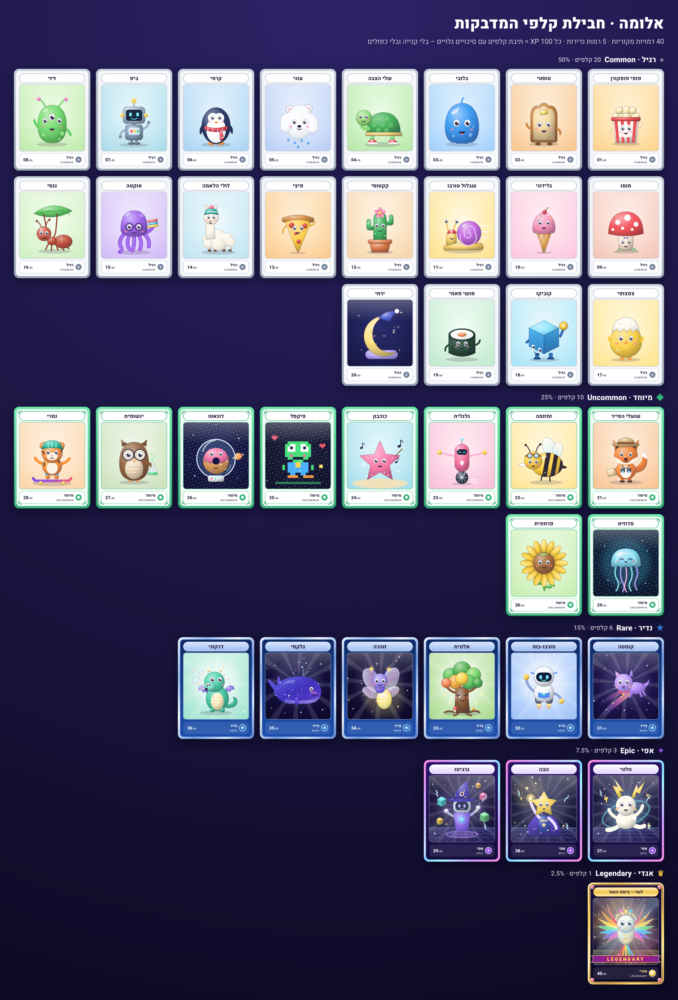

# אלומה · חבילת קלפי המדבקות

חבילה של **40 קלפי מדבקות דיגיטליים לאספנים**, לילדים בני 8 ומעלה. הקלפים הם חלק ממערכת הפרסים של אלומה. תלמידים מקבלים תיבת קלפים על כל 100 XP. ה-XP מגיע מהשקעה בלמידה: הגשות בזמן, מבחנים ותרגול בכלים של אלומה.



## עיקרון מנחה: איסוף בלי לחץ

- **כל 100 XP = תיבת קלפים.** בכל תיבה יש קלף אחד, והסיכויים קבועים ומוצגים לידה (50% / 25% / 15% / 7.5% / 2.5%).
  - **אין קנייה:** תיבות מקבלים רק מלמידה. אין כסף ואין מטבע וירטואלי.
  - **אין כפולים:** אם כבר יש לך את כל הקלפים ברמה שיצאה, מקבלים קלף מהרמה הקרובה שעוד חסרים בה קלפים. 40 תיבות = האוסף המלא.
  - **אין לחץ:** תיבות לא פגות, אין טיימרים ואין "הצעה לזמן מוגבל".
- **XP הוא מדד, לא המטרה.** ה-XP מורכב מ:
  - 40% הגשות בזמן ובאיכות;
  - 20% מבחנים;
  - 40% כלי הלמידה של אלומה.

  יש תקרה יומית לתרגול, כך שלא משתלם "לטחון" נקודות.
- **השוואה עם חברים רק בהסכמה.** מה ששותף:
  - שם פרטי, רמה, דמות, קלפים והישגים.
  - לא XP, לא ציונים ולא הגשות.

## שיטת הנדירות

הכמויות באוסף קבועות, וסיכוי הרמה בכל תיבה שווה לחלק שלה באוסף.

| רמה | כמות | סיכוי בתיבה | סמל | עיצוב |
|---|---|---|---|---|
| **רגיל · Common** | 20 | 50% | ● | מסגרת פשוטה, צבעים נקיים והצללה עדינה. בלי אפקטים |
| **מיוחד · Uncommon** | 10 | 25% | ◆ | מסגרת מעוטרת עם פינות, רקע עם דוגמה גרפית, מעט נצנצים |
| **נדיר · Rare** | 6 | 15% | ★ | מסגרת מתכתית, קרני אור, זוהר מאחורי הדמות, רקע עם עומק |
| **אפי · Epic** | 3 | 7.5% | ✦ | מסגרת כרום בצבעי קשת עם ברק, ברקי אנרגיה, חלקיקים, רצפה תלת־ממדית זוהרת, פוזות דינמיות |
| **אגדי · Legendary** | 1 | 2.5% | ♛ | מסגרת זהב תלת־ממדית עם אבני חן, הולוגרמת קשת, הילה, שכבות תאורה, הכי הרבה ניצוצות, סרט **LEGENDARY** |

## מבנה כל קלף

- **צורה:** מלבן עם פינות מעוגלות, ביחס **3:4** (600×800 ב-SVG, ו-1200×1600 ב-PNG).
- **למעלה:** שם הדמות.
- **במרכז:** הדמות, על רקע שמתאים לאופי שלה.
- **בתחתית:**
  - רמת הנדירות בעברית ובאנגלית, עם סמל;
  - מספר סידורי (למשל `01/40`).

## עולם הדמויות

40 דמויות **מקוריות לחלוטין**, כל אחת עם שם, אישיות וצבעוניות משלה:

- חיות מצחיקות;
- רובוטים;
- חייזרים;
- מפלצות חמודות;
- יצורי פנטזיה;
- מאכלים עם פרצופים;
- דמויות גיימינג;
- דמויות חלל.

כל דמות מצוירת ב**פונקציה נפרדת** משלה, כך שאין "אותו איור בצבע אחר". הרשימה המלאה נמצאת ב-[catalog.md](catalog.md).

### בטיחות (גיל 8+)

בקלפים אין:

- אלימות, נשקים, דם או פציעות;
- תוכן מיני;
- עישון, אלכוהול או סמים;
- קללות או בריונות;
- אימה.

כמה החלטות עיצוב בהתאם:

- הדרקון נושף **בועות סבון** במקום אש.
- לנמלה יש **כוח להרים עלה**.
- לכל דמות יש חיוך.

## איך זה נבנה

**למה SVG ולא מחולל תמונות?** בדקנו קודם מה זמין בסביבה:

- HeyGen ו-Magnific עולים קרדיטים (ב-Magnific אין קרדיטים בכלל).
- מחוללי תמונות מתקשים בטקסט עברי ובשמירה על מבנה אחיד.
- ההנחיה דרשה **קובץ SVG נפרד לכל קלף**.

לכן כל האיורים נבנו ב-**SVG מפורט שנכתב ידנית**:

- **מראה תלת־ממדי מצויר:** מעברי צבע רדיאליים (highlight, base, rim), ברקים מבריקים (glossy highlights) וצללים רכים.
- **אפקטים:** פילטרים של זוהר (glow), דוגמאות (patterns), הולוגרמה (holographic) וחלקיקים.

כדי שהקלפים ייראו אותו דבר בכל מקום, גם בלי אינטרנט, הגופן **Heebo** (רישיון SIL Open Font License) מוטמע בכל SVG.

| קובץ | תפקיד |
|---|---|
| `aluma/js/cards.js` | הקטלוג: שם, נדירות, סוג, אישיות וכלל פתיחה |
| `aluma/js/cardart.js` | האיורים, המסגרות והאפקטים לפי נדירות. אותו קוד מצייר את הקלפים באפליקציה ובקבצים |
| `aluma/tools/build-cards.mjs` | מייצר את כל הקבצים ומריץ בקרת איכות |

### בנייה מחדש

```bash
node aluma/tools/build-cards.mjs        # צריך Playwright + Chromium; pngquant (לא חובה) מקטין את קובצי ה-PNG
```

## תוכן התיקייה

```
cards/
├── 1-common/        20 קלפים · NN-name.png + NN-name.svg
├── 2-uncommon/      10 קלפים
├── 3-rare/           6 קלפים
├── 4-epic/           3 קלפים
├── 5-legendary/      1 קלף
├── preview.png      כל 40 הקלפים בתמונה אחת
├── catalog.md       קטלוג: מספר, שם, נדירות, סוג, אישיות, כלל פתיחה, קישורים
├── catalog.csv      אותו קטלוג לגיליון (UTF-8)
├── catalog.json     אותו קטלוג למפתחים
├── qa-report.md     תוצאות בקרת האיכות
└── README.md
```

## בקרת איכות

הבדיקות רצות אוטומטית בכל בנייה. התוצאות ב-[qa-report.md](qa-report.md).

- **כמויות:**
  - בדיוק 40 קלפים: 20 / 10 / 6 / 3 / 1;
  - מספרים 01–40 בלי כפילויות;
  - כל השמות שונים.
- **כל האיורים שונים:**
  - גם אחרי שמסירים את כל הצבעים, אין שני קלפים זהים.
- **הבדל ברור בין רמות הנדירות:**
  - כמות האפקטים עולה עם כל רמה;
  - קלף ה-Legendary הוא המושקע ביותר בפער גדול.
- **פרטים על כל קלף:**
  - מספר סידורי, רמת נדירות עם סמל, ויחס 3:4.
- **בטיחות ופתיחה:**
  - אין מילים לא מתאימות בשמות ובתיאורים;
  - סיכויי התיבה מסתכמים ל-100%, שווים לחלק של כל רמה באוסף, ותואמים בסימולציה של 200,000 תיבות.
  - 40 תיבות נותנות בדיוק את 40 הקלפים, בלי כפולים.
